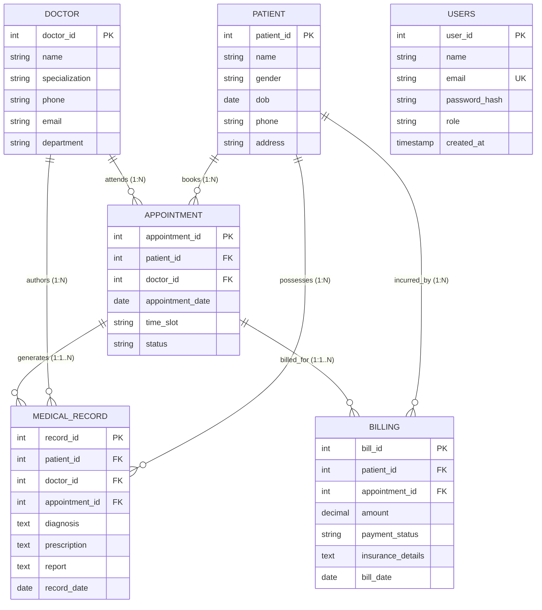

# Entity-Relationship (ER) Diagram & Relational Architecture
## CarePoint Hospital Management System (HMS)

---

### 1. Architectural Summary
The CarePoint Hospital Management System is modeled as a normalized relational schema satisfying **Third Normal Form (3NF)**. The database consists of **five core operational entities** that represent the hospital's clinical and administrative domain, accompanied by an authentication credential entity (`users`).

- **Vector Diagram**: [er_diagram.svg](diagrams/er_diagram.svg)
- **Mermaid Source**: [er_diagram.mmd](diagrams/er_diagram.mmd)

---

### 2. Entity Details & Schema Specifications

#### A. `patient` (Strong Entity)
Represents individuals registered for outpatient or inpatient healthcare services.
- **`patient_id`** (INT, Primary Key, Auto Increment): Unique identifier assigned upon initial registration.
- **`name`** (VARCHAR(100), NOT NULL): Legal name of the patient.
- **`gender`** (VARCHAR(20), NULL): Biological or self-identified gender.
- **`dob`** (DATE, NULL): Date of birth; used to derive age for clinical evaluation.
- **`phone`** (VARCHAR(15), NULL): Primary contact number for appointment confirmation.
- **`address`** (VARCHAR(255), NULL): Residential location.

#### B. `doctor` (Strong Entity)
Represents licensed medical practitioners and consultants employed by the hospital.
- **`doctor_id`** (INT, Primary Key, Auto Increment): Unique physician identifier.
- **`name`** (VARCHAR(100), NOT NULL): Doctor's full name including professional title (e.g., Dr. Amit Sharma).
- **`specialization`** (VARCHAR(100), NULL): Field of clinical expertise (e.g., Cardiologist, Neurologist, Pediatrician).
- **`department`** (VARCHAR(100), NULL): Hospital clinical division (e.g., Cardiology, General Medicine).
- **`phone`** (VARCHAR(15), NULL): Professional telephone number.
- **`email`** (VARCHAR(100), NULL): Official hospital correspondence email address.

#### C. `appointment` (Weak Entity / Relationship Entity)
Represents a scheduled consultation between a specific patient and an attending physician.
- **`appointment_id`** (INT, Primary Key, Auto Increment): Unique booking reference number.
- **`patient_id`** (INT, Foreign Key, NOT NULL): References `patient.patient_id`.
- **`doctor_id`** (INT, Foreign Key, NOT NULL): References `doctor.doctor_id`.
- **`appointment_date`** (DATE, NOT NULL): The calendar date of the scheduled visit.
- **`time_slot`** (VARCHAR(30), NULL): Consultation window (e.g., '10:00 AM', '02:30 PM').
- **`status`** (VARCHAR(30), DEFAULT 'Scheduled'): Lifecycle state (`Scheduled`, `Completed`, `Cancelled`).

#### D. `medical_record` (Relationship Entity)
Encapsulates clinical diagnostic data authored by a physician for a patient during a consultation.
- **`record_id`** (INT, Primary Key, Auto Increment): Unique electronic health record (EHR) entry ID.
- **`patient_id`** (INT, Foreign Key, NOT NULL): References `patient.patient_id`.
- **`doctor_id`** (INT, Foreign Key, NOT NULL): References `doctor.doctor_id`.
- **`appointment_id`** (INT, Foreign Key, NOT NULL): References `appointment.appointment_id`.
- **`diagnosis`** (TEXT, NULL): Clinical assessment and disease identification.
- **`prescription`** (TEXT, NULL): Prescribed pharmaceuticals, dosage, and frequency.
- **`report`** (TEXT, NULL): Physical exam observations, vital signs, or laboratory findings.
- **`record_date`** (DATE, DEFAULT `CURDATE()`): Date clinical charting was entered.

#### E. `billing` (Relationship Entity)
Tracks financial obligations, invoices, insurance claims, and payments generated from hospital services.
- **`bill_id`** (INT, Primary Key, Auto Increment): Official hospital tax invoice number.
- **`patient_id`** (INT, Foreign Key, NOT NULL): References `patient.patient_id`.
- **`appointment_id`** (INT, Foreign Key, NOT NULL): References `appointment.appointment_id`.
- **`amount`** (DECIMAL(10,2), NOT NULL): Billed consultation, medicine, and procedure charge in INR.
- **`payment_status`** (VARCHAR(30), DEFAULT 'Pending'): Financial collection state (`Paid`, `Pending`, `Partially Paid`).
- **`insurance_details`** (TEXT, NULL): Third-party payer details, policy number, or 'Self-pay / Direct'.
- **`bill_date`** (DATE, DEFAULT `CURDATE()`): Date invoice was issued.

#### F. `users` (System Security Entity)
Maintains administrative credentials and role-based permissions for staff accessing CarePoint.
- **`user_id`** (INT, Primary Key, Auto Increment): Unique user account ID.
- **`name`** (VARCHAR(100), NOT NULL): Full name of the hospital staff member.
- **`email`** (VARCHAR(100), UNIQUE, NOT NULL): Unique corporate email address used for login.
- **`password_hash`** (VARCHAR(255), NOT NULL): Salted cryptographic scrypt hash of the password.
- **`role`** (VARCHAR(30), DEFAULT 'Staff'): Role designation (`Administrator` or `Staff`).
- **`created_at`** (TIMESTAMP, DEFAULT `CURRENT_TIMESTAMP`): Account registration timestamp.

---

### 3. Cardinality & Relational Mappings

1. **Patient to Appointment ($1 : N$)**:
   - One patient can book zero, one, or multiple appointments.
   - Each appointment must belong strictly to exactly one registered patient.
2. **Doctor to Appointment ($1 : N$)**:
   - One physician can attend zero, one, or multiple scheduled appointments.
   - Each appointment is assigned to exactly one doctor.
3. **Appointment to Medical Record ($1 : 1\text{ or }1 : N$)**:
   - An appointment can lead to the creation of a clinical medical record upon consultation completion.
   - Each medical record links back to the consultation appointment.
4. **Appointment to Billing ($1 : 1\text{ or }1 : N$)**:
   - An appointment can generate an official hospital billing invoice.
   - Each invoice corresponds to an appointment and the patient who attended it.
5. **Referential Integrity Enforcement**:
   - All foreign keys enforce `ON DELETE NO ACTION` / `RESTRICT`.
   - The application checks dependent child rows before any delete operation and informs the operator of the exact referential barriers.

