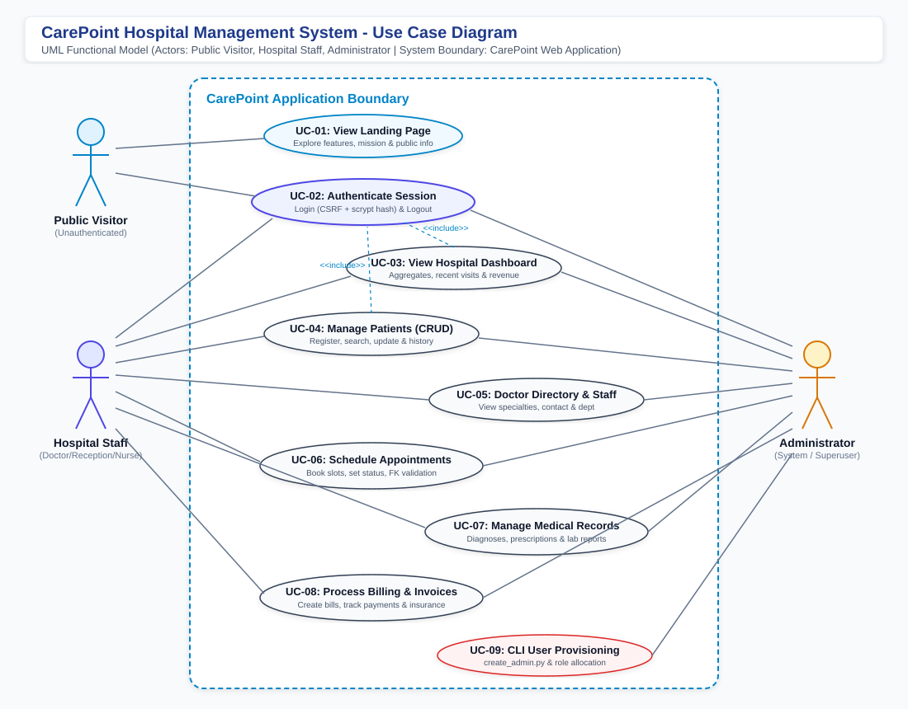

# Use Case Documentation

## CarePoint Hospital Management System

---

## 1. Introduction & Scope

The **CarePoint Hospital Management System (HMS)** provides role-based workflows for hospital personnel to coordinate clinical operations, schedule patient consults, log diagnostic records, and process billing invoices.

This document details the functional actors, use case definitions, actor-to-use-case traceability matrix, and behavioral specifications compliant with standard UML modeling guidelines for academic DBMS reporting.

---

## 2. System Actors

| Actor | Type | Description | Permissions & Responsibilities |
| :--- | :--- | :--- | :--- |
| **Public Visitor** | Human (External) | Any unauthenticated person accessing the web portal via a browser. | Accesses the public landing page (`/`), inspects feature overviews and hospital mission, navigates to the login prompt. Cannot view patient or operational data. |
| **Hospital Staff** | Human (Internal) | Clinical and administrative employees (Doctors, Nurses, Receptionists, Billing Clerks). | Authenticates with valid email and password; manages patient profiles, schedules appointments, updates medical records, issues bills, and monitors the main dashboard. |
| **Administrator** | Human (Superuser) | System administrator and senior hospital authority. | Inherits all Staff privileges; additionally manages system initialization, triggers CLI account provisioning (`create_admin.py`), and oversees cross-departmental operations and audit records. |
| **MySQL DBMS Engine** | External System | Relational database server running on `localhost:3306`. | Enforces relational integrity, foreign key cascades/restrictions, data persistence, and transaction isolation (`READ COMMITTED`). |

---

## 3. High-Level Use Case Diagram

The visual diagram illustrates the system boundary, external actors, and the core functional use cases:



---

## 4. Actor-to-Use-Case Traceability Matrix

| Use Case ID | Use Case Name | Public Visitor | Hospital Staff | Administrator |
| :---: | :--- | :---: | :---: | :---: |
| **UC-01** | View Public Landing Page | ✓ | ✓ | ✓ |
| **UC-02** | Authenticate Session (Login / Logout) | ✓ (Login only) | ✓ | ✓ |
| **UC-03** | View Hospital Dashboard & Metrics | ✗ | ✓ | ✓ |
| **UC-04** | Manage Patient Directory (CRUD) | ✗ | ✓ | ✓ |
| **UC-05** | View Doctor Directory & Specialties | ✗ | ✓ | ✓ |
| **UC-06** | Schedule & Track Appointments | ✗ | ✓ | ✓ |
| **UC-07** | Maintain Electronic Medical Records | ✗ | ✓ | ✓ |
| **UC-08** | Generate & Track Patient Billing | ✗ | ✓ | ✓ |
| **UC-09** | CLI User Provisioning & Password Hashing | ✗ | ✗ | ✓ |
| **UC-10** | Staff Self-Registration (`/signup`) | ✓ | ✗ | ✗ |
| **UC-11** | Admin Approval & User Governance (`/admin/users`) | ✗ | ✗ | ✓ |

---

## 5. Detailed Use Case Specifications

### UC-01: View Public Landing Page
- **Primary Actor**: Public Visitor
- **Preconditions**: Web server is active and accessible at `http://127.0.0.1:5000/`.
- **Trigger**: Visitor navigates to the root URL `/`.
- **Main Flow**:
  1. System serves `landing.html` containing CarePoint branding, hero statement, hospital service highlights (Patients, Doctors, Appointments, Medical Records, Billing), and footer.
  2. Visitor clicks "Get Started" or "Staff Login" button.
  3. System redirects visitor to `/login`.
- **Alternative Flow**:
  - *Already logged in*: If an active session cookie exists, system presents a direct link to `/dashboard`.
- **Postconditions**: No private patient or clinical records are revealed.

---

### UC-02: Authenticate Session (Login & Logout)
- **Primary Actor**: Hospital Staff / Administrator
- **Preconditions**:
  1. User account exists in the `users` MySQL table.
  2. User is on `/login`.
- **Trigger**: User inputs email and password and submits the login form.
- **Main Flow**:
  1. System checks CSRF token validity.
  2. System queries `users` table for the matching email.
  3. System verifies submitted password against `password_hash` using `werkzeug.security.check_password_hash`.
  4. Upon match, system creates a secure session with `user_id`, `user_name`, `user_email`, `user_role`, and sets session cookie.
  5. System redirects user to intended target route or `/dashboard`.
- **Alternative Flow (Invalid Credentials)**:
  - If email is not found or password fails hash verification, system records a generic warning ("Invalid email or password.") without revealing whether the email exists.
  - User remains on `/login` with input sanitized.
- **Sub-flow (Logout)**:
  - User clicks "Logout" in header or sidebar (`/logout`).
  - System clears all session attributes, invalidates session cookie, flashes confirmation, and redirects to `/login`.
- **Postconditions**: User session is registered or cleared accordingly.

---

### UC-03: View Hospital Dashboard & Metrics
- **Primary Actor**: Hospital Staff / Administrator
- **Preconditions**: User is successfully authenticated (`session['user_id']` is valid).
- **Trigger**: User accesses `/dashboard`.
- **Main Flow**:
  1. `@login_required` decorator validates session.
  2. System executes aggregate SQL queries:
     - `COUNT(*)` for total patients, doctors, scheduled appointments.
     - `SUM(amount)` for paid hospital revenue.
     - Top 5 recent appointments joined with `patient` and `doctor` tables.
  3. System populates KPI cards and recent appointments table in `dashboard.html`.
- **Postconditions**: System provides real-time operational overview.

---

### UC-04: Manage Patient Directory (CRUD)
- **Primary Actor**: Hospital Staff / Administrator
- **Preconditions**: Authenticated session.
- **Trigger**: Staff navigates to `/patients` or clicks "Register Patient".
- **Main Flow**:
  1. **Read**: System queries `SELECT * FROM patient ORDER BY patient_id DESC` and renders responsive data table with search.
  2. **Create**: Staff fills modal/form (Name, Gender, DOB, Phone, Address). System inserts record via parameterized SQL.
  3. **Update**: Staff clicks "Edit", updates fields, and submits. System executes `UPDATE patient SET ... WHERE patient_id = %s`.
  4. **Delete**: Staff clicks "Delete". System performs safety check across child tables (`appointment`, `medical_record`, `billing`). If no references exist, record is deleted.
- **Alternative Flow (Foreign Key Conflict)**:
  - If patient has associated appointments or bills, deletion is safely blocked with a friendly warning message, avoiding MySQL error 1451.
- **Postconditions**: Patient table is updated with transaction committed.

---

### UC-05: View Doctor Directory & Specialties
- **Primary Actor**: Hospital Staff / Administrator
- **Preconditions**: Authenticated session.
- **Trigger**: Staff navigates to `/doctors`.
- **Main Flow**:
  1. System executes `SELECT * FROM doctor ORDER BY name ASC`.
  2. System displays doctor cards with Name, Department, Specialization, Phone, and Email.
  3. System enables department filtering (Cardiology, Neurology, Pediatrics, Orthopedics, General Medicine).
- **Postconditions**: Directory is displayed with verified clinical contacts.

---

### UC-06: Schedule & Track Appointments
- **Primary Actor**: Hospital Staff / Administrator
- **Preconditions**: Authenticated session; valid patient and doctor records exist.
- **Trigger**: Staff navigates to `/appointments` and clicks "New Appointment".
- **Main Flow**:
  1. System populates dropdowns with registered patients and active doctors.
  2. Staff selects Patient, Doctor, Date, Time Slot, and initial status (`Scheduled`).
  3. System executes parameterized `INSERT INTO appointment (...) VALUES (...)`.
  4. Staff can update status to `Completed` or `Cancelled` directly from the list.
- **Postconditions**: Appointment row is committed with valid foreign keys.

---

### UC-07: Maintain Electronic Medical Records
- **Primary Actor**: Hospital Staff (Doctor / Nurse)
- **Preconditions**: Authenticated session; linked patient, doctor, and appointment exist.
- **Trigger**: Staff accesses `/medical-records` to log clinical notes.
- **Main Flow**:
  1. Staff inputs Patient ID, Doctor ID, Appointment ID, Diagnosis, Prescription, and Lab Report summary.
  2. System commits new record with current timestamp (`record_date`).
  3. System displays searchable history linking diagnostic notes with doctor and patient metadata.
- **Postconditions**: Confidential medical record is persisted in `medical_record` table.

---

### UC-08: Process Billing & Invoices
- **Primary Actor**: Hospital Staff (Billing Clerk / Administrator)
- **Preconditions**: Authenticated session; appointment has been scheduled or completed.
- **Trigger**: Staff accesses `/billing` to issue an invoice.
- **Main Flow**:
  1. Staff selects Patient and Appointment ID, enters bill amount, payment status (`Pending` or `Paid`), and insurance details.
  2. System saves invoice into `billing` table with `bill_date`.
  3. Staff can toggle payment status from `Pending` to `Paid` upon fee settlement.
- **Postconditions**: Bill record is committed and reflected in the dashboard revenue KPI.

---

### UC-09: CLI User Provisioning & Password Hashing
- **Primary Actor**: Administrator / System Operator
- **Preconditions**: Terminal access to the host environment (`D:\HMS`).
- **Trigger**: Admin runs `python create_admin.py` with email and password arguments or interactive prompts.
- **Main Flow**:
  1. Script prompts for staff full name, email, password, and role.
  2. Script invokes `werkzeug.security.generate_password_hash(password, method='scrypt')`.
  3. Script inserts row into `users` table:
     ```sql
     INSERT INTO users (name, email, password_hash, role)
     VALUES (%s, %s, %s, %s)
     ```
  4. Script outputs success confirmation with zero plaintext password logging.
- **Postconditions**: New account is immediately eligible for authentication at `/login`.

---

### UC-10: Staff Self-Registration
- **Primary Actor**: Public Visitor (Prospective Hospital Staff)
- **Preconditions**: Visitor has navigated to `/signup`.
- **Trigger**: Visitor completes registration form (Name, Email, Password, Password Confirmation) and clicks "Register Account".
- **Main Flow**:
  1. System checks CSRF token validity.
  2. System validates input constraints (Name >=2 chars, valid email format, Password >=8 chars, Password matching confirmation).
  3. System queries `users` table to verify email uniqueness.
  4. System hashes the password using `werkzeug.security.generate_password_hash(password, method='scrypt')`.
  5. System executes parameterized `INSERT INTO users (name, email, password_hash, role, status) VALUES (%s, %s, %s, 'Staff', 'Pending')`.
  6. System flashes success message informing applicant that their account is pending administrator review and redirects to `/login`.
- **Alternative Flows**:
  - *Duplicate Email*: If email already exists, system rejects with HTTP 409 and flashes "An account with this email address already exists."
  - *Validation Failure*: If password is shorter than 8 characters or passwords do not match, system renders `/signup` with clear inline error.
- **Postconditions**: A new user record is created in MySQL with `role='Staff'` and `status='Pending'`. The applicant cannot log in until approved.

---

### UC-11: Admin Approval & User Governance
- **Primary Actor**: Administrator
- **Preconditions**: Authenticated session with `session['user_role'] == 'Administrator'`.
- **Trigger**: Administrator accesses `/admin/users` via navigation or dashboard badge.
- **Main Flow**:
  1. `@admin_required` decorator verifies administrator role.
  2. System queries all users ordered by creation date, categorizing by status (`Pending`, `Approved`, `Rejected`, `Disabled`).
  3. Administrator reviews pending registrations and clicks "Approve" (updating status to `Approved`) or "Reject" (updating status to `Rejected`).
  4. System executes parameterized `UPDATE users SET status = %s WHERE user_id = %s`.
  5. Administrator can toggle roles between `Staff` and `Administrator`, or toggle status to `Disabled`.
  6. System prevents administrator from deleting their own account or demoting/deleting the sole remaining administrator.
- **Postconditions**: User record status is updated. Approved staff can now authenticate via `/login`.

